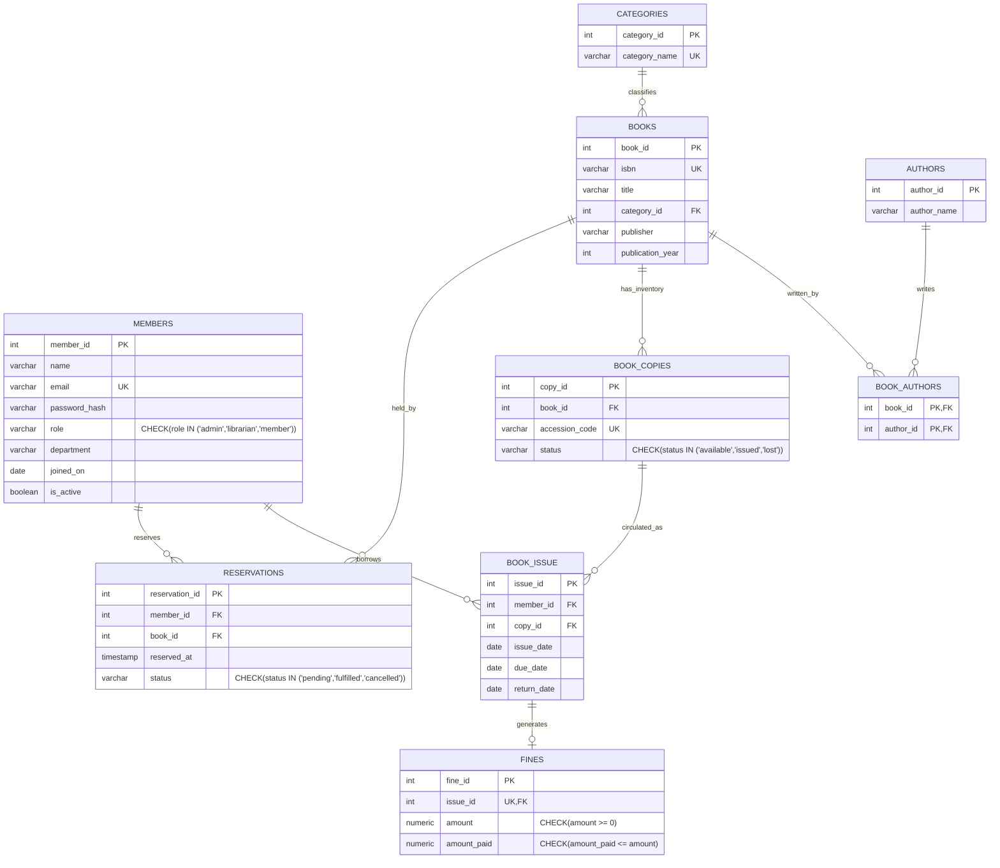

# 📚 Smart Library Management System (College DBMS Project)

A complete, production-grade **Smart Library Management System** web application developed for academic database management system (DBMS) coursework and demonstrations.

---

## 🌟 Tech Stack

| Layer | Technologies |
|---|---|
| **Frontend** | Plain HTML5, Modern CSS3 (Responsive Grid & Flexbox), Vanilla JavaScript (ES6+ Fetch API, zero frameworks or build tools) |
| **Backend** | Python 3, Flask REST API (JSON), `flask-cors`, `python-dotenv` |
| **Security** | `werkzeug.security` (`generate_password_hash`, `check_password_hash`), HTTP-only Session Cookies |
| **Database** | PostgreSQL via `psycopg2` (100% parameterized queries `%s`, ACID transaction management with `commit`/`rollback`) |
| **Data Architecture** | Single Unified Repository Pattern (`repository.py`) supporting instant switching between In-Memory Mock Data and PostgreSQL |

---

## 👥 Seed User Accounts & Credentials

The seed users below work identically in **both** modes (**In-Memory Mock Mode** and **PostgreSQL Database Mode**):

| Role | Name | Email | Password | Department | Permissions |
|---|---|---|---|---|---|
| **Admin** | System Administrator | `admin@library.edu` | `admin123` | Administration | Full privileges: manage books, copies, issue/return, view members, record fines |
| **Librarian** | Eleanor Vance | `librarian@library.edu` | `librarian123` | Central Library | Circulation desk, issue/return books, add copies, record fine payments |
| **Member** | John Doe | `john.doe@student.edu` | `member123` | Computer Science | Search catalog, place reservations, view personal loans & due dates |
| **Member** | Alice Smith | `alice.smith@student.edu` | `member123` | Information Technology | Search catalog, test reservations on fully-booked items |
| **Member** | Bob Taylor | `bob.taylor@student.edu` | `member123` | Electrical Engineering | View loan history, inspect and pay overdue fines |

> 💡 **Quick Sign-In**: The login screen (`login.html`) includes 1-click credential buttons to automatically autofill demo accounts.

---

## 🚀 Part 1: How to Run in Mock Mode (Right Now)

The database is **not required** to test and evaluate the entire application right away. The app defaults to `USE_DB=false`.

### Step 1: Open Terminal in the project directory
```bash
cd library-app
```

### Step 2: Install Python dependencies
```bash
pip install -r requirements.txt
```
*(Dependencies: `Flask`, `flask-cors`, `python-dotenv`, `werkzeug`, `psycopg2-binary`)*

### Step 3: Verify `.env` configuration
Ensure your `.env` contains:
```ini
USE_DB=false
SECRET_KEY=smartlib_dev_secret_key_change_in_production_2026
```

### Step 4: Run the Flask server
```bash
python app.py
```

### Step 5: Open your web browser
Visit: **[http://localhost:5000](http://localhost:5000)**

You can now immediately:
1. Search and filter book titles in the catalogue (`/books.html`).
2. Log in as **Member** (`john.doe@student.edu` / `member123`) to view active loans and see overdue warnings in red.
3. Log in as **Admin** (`admin@library.edu` / `admin123`) or **Librarian** to issue books, process returns, add new titles, and manage fines.

---

## 🐘 Part 2: Exact Steps to Switch to PostgreSQL Later

When you are ready to connect the application to a live PostgreSQL server, execute these exact steps:

### Step 1: Create the PostgreSQL database
In your terminal or PowerShell (using `psql` or PostgreSQL command prompt):
```bash
createdb library_db
```
*(Or in `psql`: `CREATE DATABASE library_db;`)*

### Step 2: Execute the schema script
Run the DDL schema to create all tables, primary keys, foreign keys, and indexes:
```bash
psql -d library_db -f sql/schema.sql
```

### Step 3: Populate sample seed data
Seed the database with sample categories, authors, books, physical copies, users, active issues, reservations, and fines:
```bash
psql -d library_db -f sql/seed.sql
```

### Step 4: Configure `.env`
Open `.env` and set `USE_DB=true` with your PostgreSQL credentials:
```ini
USE_DB=true
DB_HOST=localhost
DB_PORT=5432
DB_NAME=library_db
DB_USER=postgres
DB_PASSWORD=your_postgres_password
SECRET_KEY=smartlib_dev_secret_key_change_in_production_2026
```

### Step 5: Restart the application
```bash
python app.py
```
Terminal will output:
```
Starting Smart Library Management System on port 5000...
Mode: PostgreSQL Database (USE_DB=true)
```
> **Notice**: Because routes only communicate through `repository.py`, zero routes or frontend files require any modifications when switching modes!

---

## 🗄️ Database Schema & Relational Design

The relational schema complies with third normal form (3NF) and includes strict check constraints:



---

## 📋 Business Rules Implemented

1. **Book Issuing**:
   - A copy can only be issued if its status is `'available'`.
   - Once issued, copy status transitions to `'issued'`.
   - Default `due_date` is 14 days after `issue_date`.
   - A member can hold a maximum of **3 unreturned books** concurrently. Attempts to borrow a 4th book are rejected with `HTTP 400`.
   - If the member had an active reservation for this book, it is marked as `'fulfilled'`.
2. **Book Returns**:
   - Setting `return_date` resets the copy status back to `'available'`.
   - If returned after `due_date`, an overdue fine is created:
     $$\text{Fine Amount} = 2 \times \text{Days Overdue}$$
   - Executed within an ACID database transaction.
3. **Reservations**:
   - A member can reserve a book **only when 0 copies are available** (all copies currently issued or lost).
   - If available copies exist on shelf, the app instructs the user to borrow directly.
   - Prevents duplicate pending reservations by the same member for the same book.
4. **Role-Based Access Control (RBAC)**:
   - `member`: Search catalog, place reservations, view personal loans and fines.
   - `librarian` and `admin`: Issue and return books, add titles/authors/categories, register physical copies, view members, record fine payments.

---

## 🌐 REST API Endpoints Overview

| Method | Endpoint | Access | Description |
|---|---|---|---|
| `POST` | `/api/auth/register` | Public | Register new member account |
| `POST` | `/api/auth/login` | Public | Authenticate user & start session |
| `POST` | `/api/auth/logout` | Authenticated | Terminate session |
| `GET` | `/api/me` | Authenticated | Retrieve current user profile |
| `GET` | `/api/books` | Public | List books with search (`q`) & filter (`category_id`) |
| `GET` | `/api/books/<id>` | Public | Retrieve book details and physical copies |
| `POST` | `/api/books` | Staff | Register new book title in catalog |
| `PUT` | `/api/books/<id>` | Staff | Update book metadata |
| `DELETE` | `/api/books/<id>` | Staff | Delete book from catalog |
| `GET` | `/api/categories` | Public | List categories with book counts |
| `POST` | `/api/categories` | Staff | Create new category |
| `GET` | `/api/authors` | Public | List authors with book counts |
| `POST` | `/api/authors` | Staff | Add author |
| `GET` | `/api/copies?book_id=` | Public | List physical copies |
| `POST` | `/api/books/<id>/copies` | Staff | Register new physical copy accession code |
| `POST` | `/api/issue` | Staff | Issue book copy to member (atomic transaction) |
| `POST` | `/api/return/<issue_id>` | Staff | Return book & auto-generate fine if overdue |
| `GET` | `/api/issues` | Auth / Staff | List issues (member: own; staff: all) |
| `POST` | `/api/reservations` | Member | Reserve book when 0 copies available |
| `GET` | `/api/reservations` | Auth / Staff | List reservations (member: own; staff: all) |
| `DELETE` | `/api/reservations/<id>` | Auth | Cancel pending reservation |
| `GET` | `/api/fines` | Auth / Staff | List fines (member: own; staff: all) |
| `POST` | `/api/fines/<id>/pay` | Staff | Record payment against fine |
| `GET` | `/api/members` | Staff | List members with active loan counts |
| `GET` | `/api/stats` | Auth | Get dashboard circulation statistics |

---

## 📁 Project Directory Structure

```text
library-app/
├── app.py                  # Flask application entrypoint & REST routing
├── config.py               # Application configuration & environment loader
├── db.py                   # PostgreSQL connection & transaction utilities (psycopg2)
├── repository.py           # Unified Data Access Layer (switching DB vs Mock)
├── mock_data.py            # In-memory datasets, counters & business logic
├── requirements.txt        # Python dependency manifest
├── .env.example            # Environment variables template
├── .env                    # Active local environment settings (default USE_DB=false)
├── README.md               # Project documentation & database guides
├── sql/
│   ├── schema.sql          # PostgreSQL DDL table creation & indexes
│   └── seed.sql            # PostgreSQL seed script with realistic data
├── static/
│   ├── css/
│   │   └── style.css       # Responsive design system & overdue red styling
│   └── js/
│       ├── api.js          # Shared AJAX fetch client, toast UI, session utils
│       ├── index.js        # Home page interaction, hero search & stats
│       ├── login.js        # Sign-in form & 1-click credentials autofill
│       ├── register.js     # User registration logic
│       ├── books.js        # Book catalogue, search & category filtering
│       ├── book.js         # Book details, inventory status & holds
│       ├── dashboard.js    # Member dashboard, overdue loans & fines
│       └── admin.js        # Staff portal for circulation, catalog & fines
└── templates/
    ├── index.html          # Home page with hero & quick stats
    ├── login.html          # Login view
    ├── register.html       # Registration view
    ├── books.html          # Book catalog & search view
    ├── book.html           # Book details & inventory status view
    ├── dashboard.html      # Member dashboard view (overdue in red)
    └── admin.html          # Staff administrative management view
```
